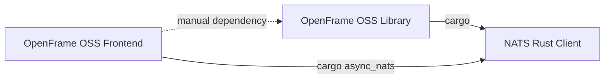

itles# Development

This section is the hub for everything related to developing **OpenFrame OSS Frontend** — the Next.js application that serves as the unified, AI-driven web interface for the OpenFrame platform. It links out to environment setup, architecture, testing, security, and contribution guides, and points you to the deeper reference material generated from the codebase.

> If you are completely new to OpenFrame, start with the [Getting Started](../getting-started/introduction.md) section first. This page assumes you already know what OpenFrame is and want to work on the frontend codebase itself.

## Overview

OpenFrame OSS Frontend (`flamingo-stack/openframe-oss-frontend`) is a monorepo-style app repository containing:

- **`apps/web`** — the primary Next.js (App Router) web application (`openframe-frontend`), built with React, TypeScript, GraphQL (Relay) and REST clients.
- **`apps/desktop`** — a Tauri-based desktop shell (`openframe-console`, Rust) that wraps the web build for native desktop delivery.
- **`apps/mobile`** — a Capacitor-based native mobile shell (`openframe-mobile`) that wraps the same web static export for iOS/Android, with native Android code under `apps/mobile/android`.

All three apps share the same underlying web UI exported from `apps/web`, and all three depend on `@flamingo-stack/openframe-frontend-core`, the shared component/hook library published from the separate [OpenFrame OSS Library](https://github.com/flamingo-stack/openframe-oss-lib) repository. According to the repository ecosystem graph, this repository publishes a `cargo` artifact (`openframe_console`, version `0.1.0`) for the desktop shell, pins `async_nats` from the NATS Rust Client repository, and depends manually on OpenFrame OSS Library. No other repository is currently recorded as a downstream consumer of this one, though graph coverage is partial — absence of a listed consumer does not prove nothing depends on it.



The development documentation is organized so you can go from "clone and run" to "understand the architecture" to "ship a change safely":

1. **Setup** — get a working local environment and understand environment variables.
2. **Architecture** — learn how the app is structured and how its modules fit together.
3. **Testing** — know what test tooling exists and how to run it.
4. **Security** — understand the auth and token-handling model you must respect.
5. **Contributing** — follow the conventions enforced on pull requests.

## Development documentation

| Document | What it covers |
|---|---|
| [Environment Setup](./setup/environment.md) | Required tooling, environment variables, and configuration needed before running the app locally. |
| [Local Development](./setup/local-development.md) | Day-to-day workflow: running `apps/web`, `apps/desktop`, and `apps/mobile` locally. |
| [Architecture](./architecture/README.md) | How the frontend is structured internally and how it fits the broader OpenFrame platform. |
| [Testing](./testing/README.md) | Test tooling (Vitest, Node test runner) and how to run checks before pushing. |
| [Security](./security/README.md) | Authentication, token lifecycle, and other security-sensitive behavior developers must preserve. |
| [Contributing Guidelines](./contributing/guidelines.md) | Conventions and review rules enforced on contributions to this repository. |

## Quick navigation guide

Use this guide to find what you need quickly:

- **"I just cloned the repo and want it running."** → Start with [Environment Setup](./setup/environment.md), then [Local Development](./setup/local-development.md).
- **"I need to understand how a feature module (customers, devices, tickets, Mingo AI chat, etc.) is organized."** → Go to [Architecture](./architecture/README.md), which links into the generated module reference under `docs/reference/architecture/`.
- **"I'm about to touch the API client, auth, or token refresh logic."** → Read [Security](./security/README.md) first — this codebase has specific safeguards around token rotation and multi-tenant host resolution that must not be broken.
- **"I want to run or write tests before opening a PR."** → See [Testing](./testing/README.md).
- **"I'm ready to open a pull request."** → Check [Contributing Guidelines](./contributing/guidelines.md) for the conventions enforced in code review.
- **"I want the deep, auto-generated architectural reference (per-module diagrams and responsibilities)."** → See [Architecture Reference](../reference/architecture/README.md), and from there the module-level pages such as [API Client](../reference/architecture/api-client/api-client.md) and [Frontend Core](../reference/architecture/frontend-core/frontend-core.md).

## Repository layout at a glance

```text
apps/
  web/        Next.js app (openframe-frontend) — the primary UI
  desktop/    Tauri shell (openframe-console) — wraps the web build for desktop
  mobile/     Capacitor shell (openframe-mobile) — wraps the web build for iOS/Android
```

- `apps/web/package.json` defines the Next.js application (`next`, `react`, `react-relay`, `@tanstack/react-query`, `zustand`, `zod`, CodeMirror-based editors, and `@flamingo-stack/openframe-frontend-core` as the shared UI/hooks package).
- `apps/desktop/src-tauri/Cargo.toml` defines the Rust/Tauri shell, including the `async-nats` dependency (fetched from the `flamingo-stack/nats.rs` fork) used for the background notification plane, and platform-specific notification backends for Windows (`windows`, `winreg`) and macOS (`objc2*` crates).
- `apps/mobile/android/app/build.gradle` and `apps/mobile/android/build.gradle` define the native Android shell, including per-environment build flavors (`prod`, `stage`, `dev`) and optional release signing wired from `ANDROID_UPLOAD_*` environment variables.

> Each app has its own `package.json` (or `Cargo.toml` for the Rust shell), so dependency and script changes should be made in the correct app directory rather than at the repository root.

## A note on contribution conventions

This repository enforces a few conventions that are easy to miss if you are used to other codebases:

- **Icons**: import icons from `@flamingo-stack/openframe-frontend-core/components/icons-v2` (or `.../components/icons` for the legacy set) — `lucide-react` and `@flamingo/ui-kit` are not valid dependencies here.
- **Commit messages**: every commit must contain exactly one `[preview:...]` token (for example `[preview:none]` or `[preview:all]`) that gates which Vercel preview platform projects build for that change.
- **Duplication and test coverage**: new or changed exported definitions are checked against existing definitions in the organization for duplication, and are expected to be referenced by a test.

See [Contributing Guidelines](./contributing/guidelines.md) for the full set of conventions, and [Testing](./testing/README.md) for how to exercise your changes before opening a pull request.
