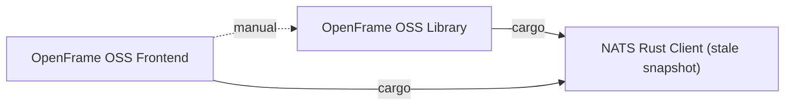
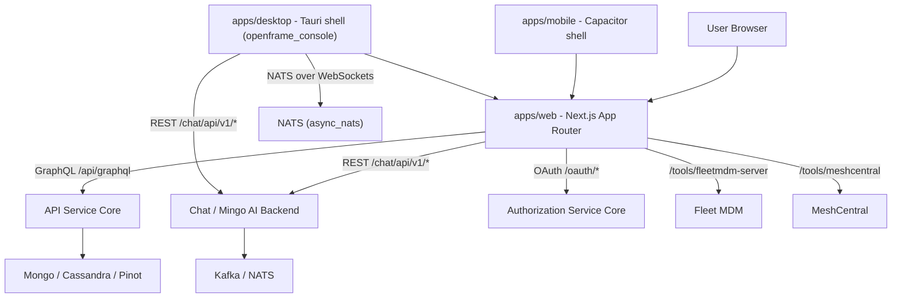
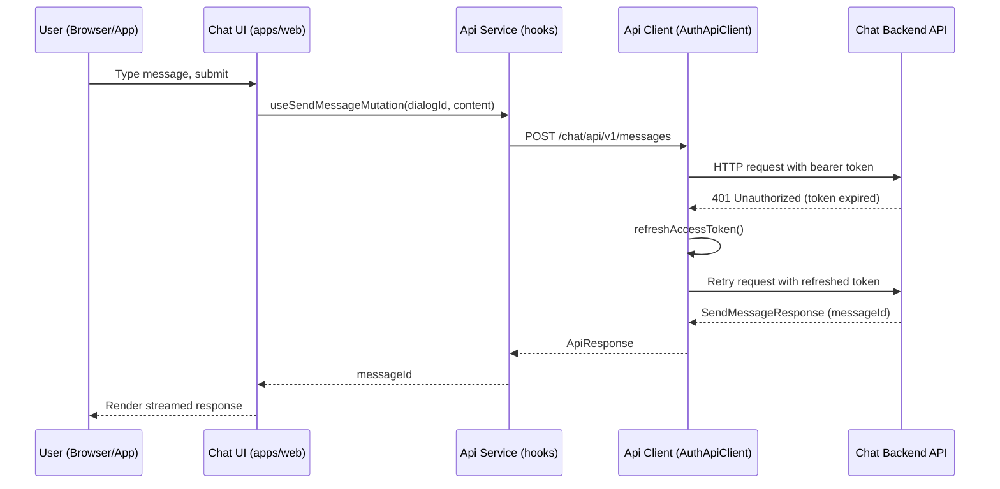

# Architecture Overview

OpenFrame OSS Frontend (`flamingo-stack/openframe-oss-frontend`) is the human-interface layer of the OpenFrame platform. It is a multi-app workspace: a Next.js web application (`apps/web`), a Capacitor-based mobile shell (`apps/mobile`), and a Tauri-based desktop console (`apps/desktop`, published as the `openframe_console` cargo artifact). All three shells embed or wrap the same web UI and talk to the same backend services over GraphQL, REST, and NATS.

> This document summarizes how the repository is organized and how it fits into the broader OpenFrame ecosystem. For a deeper tour of individual frontend modules, see the reference material referenced throughout (for example [frontend-core](../../reference/architecture/frontend-core/frontend-core.md), [api-client](../../reference/architecture/api-client/api-client.md), and [api-service](../../reference/architecture/api-service/api-service.md)).

## Repository role in the ecosystem

According to the organization's repository graph, OpenFrame OSS Frontend is registered as an **app** that publishes one artifact and pins one upstream dependency directly, with a second dependency resolved manually:

| Ecosystem | Artifact | Version |
|---|---|---|
| cargo | `openframe_console` | 0.1.0 |

| Upstream dependency | Edge type | Notes |
|---|---|---|
| `async_nats` from [NATS Rust Client](https://github.com/flamingo-stack/nats.rs) | cargo (derived) | Pulled in via the desktop shell's Rust dependencies (see `apps/desktop/src-tauri/Cargo.toml`); the upstream repository's graph snapshot is currently stale. |
| [OpenFrame OSS Library](https://github.com/flamingo-stack/openframe-oss-lib) | manual | The frontend consumes this library's published npm package (`@flamingo-stack/openframe-frontend-core`) via a manually tracked edge rather than a resolved registry dependency. |

No repository is currently recorded as a consumer of this frontend's published artifacts, and the graph's coverage for this repository is **partial** — an empty consumer list does not prove nothing depends on it, only that the indexed snapshot does not show one.

## High-level architecture

The frontend is structured as three deployable shells sharing one web codebase, all of which talk to the backend through a common API/GraphQL boundary:

### Workspace layout

| App | Purpose | Key manifest |
|---|---|---|
| `apps/web` | The primary Next.js (App Router) + React + TypeScript web application. Renders operational UI for customers, devices, tickets, knowledge base, logs, Mingo AI chat, onboarding, and billing. | `apps/web/package.json` |
| `apps/mobile` | Capacitor-based native shell (iOS/Android) that wraps the static export of `apps/web`. Contains no UI code of its own — only native bootstrap, auth bridging, push notifications, and file I/O plugins. | `apps/mobile/package.json`, `apps/mobile/android/app/build.gradle` |
| `apps/desktop` | Tauri-based desktop console, published as the `openframe_console` cargo crate. Wraps the same web bundle and adds native tray, autostart, notification actions, and a background NATS connection for push-style updates. | `apps/desktop/package.json`, `apps/desktop/src-tauri/Cargo.toml` |

The web app's scripts (`apps/web/package.json`) show the build pipeline: `npm run generate-enums` (schema enum generation), `relay-compiler` (GraphQL/Relay compilation), then `next build`. A `build:export` variant sets `OPENFRAME_BUILD_TARGET=export` to produce the static bundle that the mobile and desktop shells stage via their own `build:web` scripts (`apps/mobile/scripts/build-web.sh`, invoked from `apps/mobile/package.json`).

## Core components table

| Component | Location | Responsibility |
|---|---|---|
| Next.js App Router pages | `apps/web/src/app/(app)/**` | Route-level UI for customers, devices, tickets, knowledge base, logs, dashboard, Mingo chat, cloud tenant management, and incidents. |
| Api Client | shared frontend-core module (see [api-client](../../reference/architecture/api-client/api-client.md)) | Centralized `AuthApiClient` and `FleetApiClient` for OAuth, token refresh, and Fleet MDM REST/WebSocket calls. |
| Api Service (chat) | shared module (see [api-service](../../reference/architecture/api-service/api-service.md)) | Typed React Query mutations for Mingo AI dialogs, message sending, approval workflows, and generation control against `/chat/api/v1/*`. |
| Frontend Core | `@flamingo-stack/openframe-frontend-core` package, consumed from `apps/web/package.json` | Shared UI primitives, hooks, auth context, chat components, and feature flags used across the web app (see [frontend-core](../../reference/architecture/frontend-core/frontend-core.md)). |
| State management | React Query (`@tanstack/react-query`), Relay (`react-relay`, `relay-runtime`), Zustand (`zustand`) | Server-state caching and pagination, GraphQL fragments/streaming, and UI/session state respectively. |
| MeshCentral integration | `apps/web/src/lib/meshcentral/index.ts` | Custom remote desktop client: binary frame decoding, file manager, websocket control client (`WebSocketManager`, `MeshControlClient`, `MeshCentralFileManager`). |
| Mobile native bridge | `apps/mobile/android/app/src/main/java/ai/openframe/mobile/` | Native Capacitor plugins (`NativeAuthPlugin`, `NativeFilesPlugin`), push notification handling (`PushNotifications`, `OpenFrameMessagingService`), and token lifecycle (`TokenLifecycle`, `SecureTokenStore`). |
| Desktop native shell | `apps/desktop/src-tauri/src/` | Tauri `lib.rs`/`main.rs` entry points, autostart (`autostart.rs`), NATS client (`nats.rs`), token handling (`tokens.rs`), notification actions (`notification_actions.rs`, `chat_api.rs`), and the in-app updater (`updater.rs`). |
| Backend: Api Service Core | external repository, consumed via GraphQL/REST | Exposes REST and DGS GraphQL endpoints, DataLoaders, and JWT-based security (see [api-service-core](../../reference/architecture/api-service-core/api-service-core.md)). |
| Backend: Authorization Service Core | external repository | Multi-tenant OAuth2/OIDC authorization server issuing and validating JWTs (see [authorization-service-core](../../reference/architecture/authorization-service-core/authorization-service-core.md)). |
| Backend: Client Core | external repository | Agent authentication, machine presence, RMM command/script result ingestion over NATS (see [client-core](../../reference/architecture/client-core/client-core.md)). |

## Data flow sequence diagram

The following sequence illustrates a representative flow: a user sends a message in the Mingo AI chat UI, which goes through the shared Api Service and Api Client layers, hits the backend, and streams a response back.

Token rotation safety (captured `tokenEpoch`, single-flight refresh, no forced logout mid-flow) is handled centrally in `AuthApiClient`, as documented in [api-client](../../reference/architecture/api-client/api-client.md). The chat mutation contracts (`CreateDialogRequest`, `SendMessageRequest`, `SendMessageResponse`) are defined in the Api Service layer, documented in [api-service](../../reference/architecture/api-service/api-service.md).

For the desktop shell, a parallel but distinct flow exists: background notification actions (approve/reject a tool call, inline reply) are resolved **without opening a window**, directly from Rust code in `apps/desktop/src-tauri/src/chat_api.rs`, which calls the same `/chat/api/v1/approval-requests/{id}/approve` and `/chat/api/v1/messages` endpoints using a bearer token obtained from `tokens::ensure_fresh`.

## Key design decisions

### 1. One web codebase, three shells
Rather than maintaining separate UIs, `apps/mobile` and `apps/desktop` wrap the static export of `apps/web`. The mobile app's `package.json` description states explicitly that it is a "native mobile shell (Capacitor) — wraps the openframe-frontend static export. No UI code lives here." The desktop app's `scripts/make-placeholder-web.mjs` writes a minimal placeholder bundle into `www/` so the Tauri shell can compile without the full web export during development, with `npm run build:web` staging the real bundle for production.

### 2. Centralized API client with safe token rotation
All HTTP traffic to backend services is routed through `AuthApiClient` and `FleetApiClient` (see [api-client](../../reference/architecture/api-client/api-client.md)). This centralizes OAuth/JWT handling, retry-on-401 logic with `tokenEpoch` tracking to avoid double refresh races, and tenant-aware URL resolution (shared SaaS host vs. dedicated tenant domain vs. local development).

### 3. Relay and React Query side by side
The web app depends on both `react-relay`/`relay-runtime` (for GraphQL fragments and cursor-based pagination, e.g. logs) and `@tanstack/react-query` (for REST-backed server state and mutations). This split lets GraphQL-heavy views (logs, organizations) use Relay's connection model while REST-oriented flows (chat, Fleet MDM) use React Query mutations.

### 4. Native plugins kept thin, business logic kept in TypeScript
On mobile, native Android code (`NativeAuthPlugin.java`, `NativeFilesPlugin.java`) exists specifically to work around WebView limitations — Chrome Custom Tabs for OAuth (so an SSO session already in the system browser can be reused), biometric-gated token storage, and native file picking/upload where browser-native patterns silently fail in a Capacitor WebView. The equivalent desktop logic lives in Rust under `apps/desktop/src-tauri/src/` (for example `autostart.rs`, `notifications.rs`, `tokens.rs`).

### 5. Background NATS connection for desktop push-style updates
The desktop shell depends on `async_nats` (from the `flamingo-stack/nats.rs` fork, declared in `apps/desktop/src-tauri/Cargo.toml`) with WebSocket support, re-invoking `auth_url_callback` on every reconnect to supply a fresh bearer token riding on the connection URL. This gives the desktop app a persistent background channel for notifications without requiring the main window to be open.

### 6. Explicit context limits for AI chat payloads
The chat message contract (`SendMessageRequest`) caps `contextItems` at 10 and `recentViews` at 5, and omits empty fields entirely to preserve backward compatibility with the backend OpenAPI schema. This is a deliberate design choice documented in [api-service](../../reference/architecture/api-service/api-service.md) to prevent oversized payloads and non-deterministic AI behavior from implicit global context.

### 7. Multi-tenant awareness baked into the client layer
The Api Client module resolves base URLs differently depending on deployment mode: absolute URLs when a shared SaaS host is configured, relative paths otherwise. This lets the same frontend build run across local development, dedicated tenant domains, and shared SaaS infrastructure without rebuilding.

## Where this fits in the platform

The frontend is the presentation and orchestration layer; it does not implement business logic or persistence itself. It depends on (but does not currently show recorded consumers of its own published artifacts from) the broader OpenFrame backend ecosystem:

- **API Service Core** — GraphQL (Netflix DGS) and REST endpoints the web app queries directly.
- **Authorization Service Core** — issues the JWTs that `AuthApiClient` manages.
- **Client Core** — the agent-facing service that the frontend's device/RMM views ultimately reflect state from.
- **Data Pinot / Data Mongo Common / Data Kafka** — analytical and transactional stores behind the API layer, not accessed directly by the frontend.

Since the ecosystem index for this repository is marked **partial** coverage, treat the "no downstream consumers" fact as inconclusive rather than definitive — other repositories may depend on the `openframe_console` artifact or on frontend-exposed contracts without yet appearing in the indexed snapshot.
