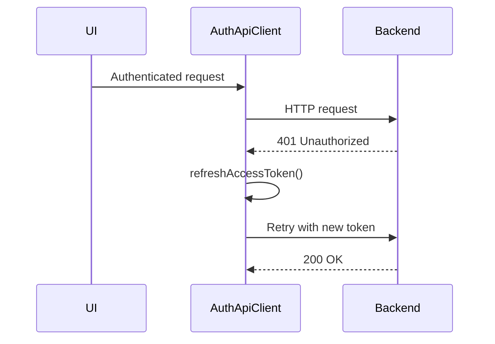

## Security

This document describes the security model implemented in the **OpenFrame OSS Frontend** repository (`flamingo-stack/openframe-oss-frontend`): how authentication and authorization are handled, how secrets and tokens are stored, how input is validated, common vulnerability classes the codebase guards against, and how to perform security-relevant code review and testing on this repository.

> This document covers the frontend application layer only. It does not describe backend authorization internals (see `authorization-service-core` reference architecture) or infrastructure-level controls (Kubernetes manifests, network policy), which live in other repositories.

---

### 1. Where security-relevant code lives

| Concern | Location |
|---|---|
| HTTP/auth client | `apps/web/src/lib` (referenced throughout as "Api Client"; see `docs/reference/architecture/api-client/api-client.md`) |
| Mobile native auth bridge | `apps/mobile/android/app/src/main/java/ai/openframe/mobile/NativeAuthPlugin.java` |
| Mobile secure token storage | `apps/mobile/android/app/src/main/java/ai/openframe/mobile/SecureTokenStore.java` |
| Mobile token lifecycle (refresh/rotation) | `apps/mobile/android/app/src/main/java/ai/openframe/mobile/TokenLifecycle.java` |
| Mobile token value object | `apps/mobile/android/app/src/main/java/ai/openframe/mobile/TokenPair.java` |
| Desktop (Tauri) token lifecycle | `apps/desktop/src-tauri/src/tokens.rs` |
| Stores (Zustand) | `apps/web/src/stores/index.ts` |
| Environment variable template | `apps/web/.env.example` |
| Repository privacy/security policy | `SECURITY.md`, `apps/mobile/SECURITY.md` |
| Dependency update policy | `renovate.json` |

The web app is built with Next.js (App Router) + React + TypeScript (`apps/web/package.json`), consuming shared UI/auth primitives from `@flamingo-stack/openframe-frontend-core`. Native shells (Android, iOS via `apps/mobile`, desktop via `apps/desktop/src-tauri`) each re-implement the same token-custody contract so the web bundle behaves identically across runtimes.

---

### 2. Authentication and authorization patterns

#### 2.1 OAuth-based login, delegated to the backend

Login is not implemented as a frontend username/password form against this repository's code. Instead, `AuthApiClient` (documented in `docs/reference/architecture/api-client/api-client.md`) drives an OAuth flow against backend endpoints (`/oauth/*`, `/sas/*`, `/me`). Key responsibilities documented for this client:

- `loginUrl()`, `oauth()`, `refresh()`, `devExchange()` for OAuth/login flows.
- `registerOrganization()`, `registerOrganizationSso()`, `discoverTenants()` for tenant registration.
- `acceptInvitation()`, `acceptInvitationSso()` for invitation flows.
- `requestPasswordReset()`, `confirmPasswordReset()` for password recovery.
- Public endpoints use `credentials: omit` and never attach a bearer token.

On native shells (Android/iOS/desktop), OAuth login is launched in a real system browser surface — Chrome Custom Tabs on Android (`NativeAuthPlugin.java`, method `start(PluginCall)`) — rather than an embedded WebView, because several identity providers (for example Google) refuse to authenticate inside an embeddable WebView. The callback is received via a dedicated deep link (`com.openframe.app://auth`) validated against a fixed scheme and host before being resolved.

#### 2.2 Token custody and refresh (single-flight)

A recurring pattern across web, Android, and desktop is **single-flight token refresh**: only one refresh request is ever in flight per session, and concurrent callers wait on that one attempt rather than issuing their own.

- Web: `AuthApiClient` captures a `tokenEpoch` before sending an authenticated request, detects `401 Unauthorized`, and calls `refreshAccessToken()`. It avoids a second refresh if the token was already rotated by a concurrent caller, and only forces logout once refresh itself fails — not on every `401`.
- Android: `TokenLifecycle.java` implements the same taxonomy as the iOS counterpart (`ios/App/App/TokenLifecycle.swift`, referenced in that file's documentation) — it distinguishes a request that **never reached** the gateway (`UNREACHED`, safe to retry) from one whose answer is **unknown** (`UNKNOWN`, must not blindly retry because the refresh token may already have rotated server-side). All token state reads/writes are serialized on a single-thread "store queue" executor.
- Desktop: `apps/desktop/src-tauri/src/tokens.rs` documents the same rationale in extensive comments — refresh tokens rotate, so a web view refresher racing a shell refresher would invalidate each other's tokens; therefore the shell is the single refresher of record, and the web bundle's token-refresh-manager delegates to it when the native bridge exposes `refreshTokens`.

> **Why this matters:** a rotation whose HTTP response is lost is **unrecoverable** — the gateway retires the presented refresh token as it issues the next one. The desktop implementation explicitly gates rotation behind a "wake settle" window (`WAKE_SETTLE_SECS`) to avoid firing a refresh immediately after a laptop resumes from sleep, when DNS/Wi-Fi may not have reassociated yet, and adds a cooldown (`LOST_ROTATION_COOLDOWN_SECS`) after a rotation of unknown outcome before re-presenting the same refresh token.

#### 2.3 Authorization surface in the UI

Authorization in this repository is primarily **tenant- and organization-scoped**, not role-based in the frontend code itself:

- Guardrails settings (`customer-guardrails-settings.tsx`, `customer-device-guardrails-settings.tsx`) implement an **inheritance + override model**: an organization either inherits tenant-default AI/remote-access policy or maintains its own materialized policy. The UI enforces this through a `commit()` imperative handle pattern driven by the parent "Save Customer" action, not by direct mutation on every keystroke.
- Read-only detail tabs (`customer-guardrails-tab.tsx`, `customer-device-guardrails-tab.tsx`) never expose mutation handlers — editing is routed exclusively through `routes.settings.aiSettings(...)`, keeping the authoritative edit surface centralized.
- Multi-tenancy is resolved at the URL/host level: `AuthApiClient` and `FleetApiClient` choose between an absolute URL (`sharedHostUrl()`, SaaS shared mode) and a relative path (tenant-isolated domain), so authorization context travels implicitly through which host a request is sent to.



---

### 3. Data encryption and secure storage

#### 3.1 Mobile token storage: `SecureTokenStore`

`apps/mobile/android/app/src/main/java/ai/openframe/mobile/SecureTokenStore.java` is the Android implementation of the token vault (mirroring the iOS Keychain equivalent). Notable design points:

- The access and refresh tokens are stored as **one combined JSON blob** (via `TokenPair.encode()`), so a biometric-gated read requires exactly one `BiometricPrompt`/`CryptoObject` unwrap for the whole pair, not two.
- **Ungated mode** (biometric login off): an AES-256-GCM master key generated inside, and never exported from, `AndroidKeyStore`. Reads and writes are silent.
- **Gated mode** (biometric login on): a hybrid envelope — each write generates a fresh random AES-256-GCM content key, encrypts the blob with it, then wraps that content key with a biometric-gated RSA-2048/OAEP **public** key. Wrapping requires no authentication, so writes (including background token refresh) stay silent; only the matching RSA **private** key, which carries `setUserAuthenticationRequired(true)` and is scoped to `AUTH_BIOMETRIC_STRONG`, can unwrap it — and that unwrap can only happen inside a `BiometricPrompt`. This is explicitly documented as avoiding the "authenticate then read an unprotected blob" antipattern: the ciphertext itself is worthless without the hardware-enforced private key.
- OAEP parameters (`SHA-256` digest, `MGF1-SHA1`) are pinned identically on both the wrap and unwrap `Cipher.init` calls, because a software crypto provider's default MGF1 digest can otherwise diverge from the Keystore's hardware-enforced MGF1-SHA1, causing unwrap failures that read as data corruption.
- `resetBiometricKey()` deletes the RSA keypair and all gated ciphertext whenever biometric login is re-enabled, specifically to avoid an unrecoverable `KeyPermanentlyInvalidatedException` loop after an enrollment change (e.g., a new fingerprint added).
- A transient Keystore failure is surfaced as `SecureTokenStore.Unavailable`, which callers must treat differently from `null` (absent token): `null` ends a session; `Unavailable` must not, because the stored item is still intact.

#### 3.2 Plain (non-secret) storage

Tenant host, shared host, and client bundle version strings are stored unencrypted in the same `SharedPreferences` file via `getPlain`/`putPlain`, because they are not sensitive — this keeps the data-extraction exclusion rules (backup/device-transfer policies) to a single file rather than two.

#### 3.3 Desktop token storage

`apps/desktop/src-tauri/src/tokens.rs` persists tokens to a file (`tokens.json` in the app config directory) using `write_atomic`, which the code comments note keeps the file owner-only; OS-keychain-backed storage is called out as tracked separately rather than implemented in that function. JWT payloads are decoded locally (`jwt_payload`) **without signature verification** — the comment is explicit that the shell only reads scheduling hints (`exp`) and identity claims (`userId`) from tokens it already trusts, not for authorization decisions.

#### 3.4 Fleet MDM WebSocket session identifiers

`FleetApiClient.getSockJsUrl()` (see `docs/reference/architecture/api-client/api-client.md`) generates server and session identifiers using **cryptographically secure randomness** with rejection sampling, explicitly to ensure even load distribution, collision avoidance, and secure session identifiers for the Fleet results WebSocket stream.

---

### 4. Input validation and sanitization

Input validation in this codebase is concentrated at two boundaries: **backend DTO contracts** (shared with this frontend via `openframe-oss-lib`) and **frontend form schemas**.

- **Shared DTO validation layer** — `docs/reference/architecture/api-lib-dto/api-lib-dto.md` documents Jakarta Bean Validation constraints applied at the API boundary: pagination page size bounds (1–100 in `ConnectionArgs`), a hard batch cap (`MAX_BATCH_SIZE = 100`) and a 600-second timeout ceiling on `BatchRunCommandInput`, and **subject-safe machine ID validation** before dispatching commands over NATS — preventing malformed or malicious machine identifiers from being used to construct NATS subjects.
- **Opaque cursors** — `CursorCodec` Base64-encodes pagination cursors so internal database identifiers (timestamps, IDs) are never exposed directly to API consumers, reducing the risk of enumeration or tampering via crafted cursor values.
- **Frontend form validation** — the web app depends on `zod` (`apps/web/package.json`) and `react-hook-form` with `@hookform/resolvers` for schema-based client-side validation, following the pattern shown in `apps/web/src/app/(app)/monitoring/policy/components/.edit-policy-page.md`: a `zod` schema (`policyFormSchema`) validates required fields before submission, with the first validation failure surfaced via a toast.
- **URL validation before native HTTP calls** — `NativeAuthPlugin.java`'s `exchangeTicket` method is a concrete example of defensive input validation: before making a dev-ticket exchange request, it parses the caller-supplied URL and rejects it unless the scheme is `https` **and** the path exactly matches the pinned `/oauth/dev-exchange` endpoint (after collapsing repeated slashes). The code comment explains why: the bridge hands the response's token headers back to page script, so this method must not become a "fetch any URL" primitive reachable from the web layer.
- **Secret-flagged script environment variables** — `ScriptEnvVarInput` (documented in `api-lib-dto.md`) includes a `secret` flag on script environment variables; the documentation notes storage is currently plaintext with masking handled externally, which is a known limitation callers of that DTO should be aware of (see §6 below).

When adding new user-facing forms or API call sites in this repository, validate with a `zod` schema (consistent with existing usage) and reject malformed input before it reaches an API client call, rather than relying solely on the backend to reject it.

---

### 5. Common security vulnerabilities and mitigations

| Vulnerability class | Where addressed in this repo | Mitigation pattern |
|---|---|---|
| Open redirect / SSRF via native bridge | `NativeAuthPlugin.java#exchangeTicket` | Pinned scheme (`https`) + pinned path (`/oauth/dev-exchange`) check before any native HTTP call is made |
| Token replay after revocation | `TokenLifecycle` (Android, desktop) | Distinguishes `UNREACHED` vs `UNKNOWN` refresh outcomes; never blindly retries a refresh whose response was lost, since the refresh token may already be spent |
| Race condition across concurrent refreshes | `AuthApiClient` (web), `TokenLifecycle` (Android/desktop) | Single-flight refresh with epoch/queue tracking; waiters join the in-flight attempt instead of issuing their own |
| Session resurrection after sign-out | `TokenLifecycle.java` (Android), `tokens.rs` (`custody_epoch`) | A monotonically bumped custody/session epoch is captured before any async operation (biometric prompt, in-flight POST); a result that arrives after sign-out is detected and dropped rather than silently reinstating the session |
| Key invalidation after biometric re-enrollment | `SecureTokenStore.resetBiometricKey()` | Keypair and all gated ciphertext are deleted and regenerated whenever biometric login is (re-)enabled, avoiding a permanent `BIOMETRIC_INVALIDATED` lock-out loop |
| NATS subject injection | `BatchRunCommandInput` (per `api-lib-dto.md`) | Subject-safe machine ID validation before publishing commands |
| Unbounded batch operations (DoS via resource exhaustion) | `BatchRunCommandInput` | Hard `MAX_BATCH_SIZE = 100` and a 600-second max timeout |
| Internal ID / cursor enumeration | `CursorCodec` | Cursors are opaque Base64-encoded composite keys, not raw database IDs |
| WebSocket session ID predictability | `FleetApiClient.getSockJsUrl()` | Cryptographically secure randomness with rejection sampling for server/session IDs |
| Leaking tokens via non-TLS or unexpected origin | `AuthApiClient` URL resolution | Explicit choice between absolute SaaS shared-host URL and same-origin relative path; public endpoints use `credentials: omit` |

#### Dependency and supply-chain hygiene

`renovate.json` encodes the dependency-update security posture for this repository:
- `osvVulnerabilityAlerts` and `vulnerabilityAlerts.enabled` are both turned on, so known-vulnerable dependency versions are flagged automatically.
- Ordinary npm dependencies require a 7-day "soak" (`minimumReleaseAge: "7 days"`) before being offered, reducing exposure to compromised just-published packages.
- GitHub Actions similarly require a 3-day soak and are pinned by digest (`helpers:pinGitHubActionDigests`).
- Docker base images are pinned by digest (`pinDigests: true`), and a Node major version bump is explicitly disabled from auto-merge (`enabled: false` under `matchUpdateTypes: ["major"]`) so it is a deliberate decision, not an automatic one.
- The `@flamingo-stack/openframe-frontend-core` dependency is tracked via a custom regex manager against `pkg.pr.new`, mapped back to the `flamingo-stack/openframe-oss-lib` repository's tags — keeping that shared UI/auth library's version visible to vulnerability tracking even though it is installed from a non-registry URL.

#### Kubernetes workload hardening (organization-wide rules)

Although this repository does not itself ship Kubernetes manifests in the material reviewed, two **active, enforced** organization rules apply wherever `manifests/**/*.yaml` or `manifests/**/values*.yaml` files exist in a repository's tree:

- **OPENFRAM-005-18** — every Deployment/Pod spec must declare `podSecurityContext` and container `securityContext` with `runAsNonRoot: true`, explicit non-root `runAsUser`/`runAsGroup`, `allowPrivilegeEscalation: false`, `capabilities.drop: [ALL]`, `privileged: false`, `readOnlyRootFilesystem: true`, and `seccompProfile.type: RuntimeDefault`.
- **OPENFRAM-009-12** — the equivalent requirement for Helm `values*.yaml` blocks (including `fsGroup` in `podSecurityContext`).

If this repository's release pipeline or any downstream deployment manifest is modified to add Kubernetes workloads, these two rules are enforced by the automated reviewer and must be satisfied.

---

### 6. Security testing and code review guidelines

#### 6.1 What to check before merging auth- or storage-related changes

- **Token custody changes** (any edit to `AuthApiClient`, `TokenLifecycle.java`, `SecureTokenStore.java`, `TokenPair.java`, or `apps/desktop/src-tauri/src/tokens.rs`) should be reviewed against the single-flight and epoch-tracking invariants described in §2.2 and §5. A change that allows two refreshes to race, or that re-applies a stale read after a sign-out, reintroduces a session-loss bug class this codebase has specifically engineered around.
- **Any new native-bridge method that accepts a URL** (mirroring `exchangeTicket`) must pin both scheme and path before issuing the request — do not add a generic "fetch this URL" bridge method.
- **New DTOs that dispatch to agents/devices** (anything resembling `RunCommandInput`/`BatchRunCommandInput` in `openframe-oss-lib`) should carry the same batch-size, timeout, and subject-safety validation already established, rather than introducing a parallel, less-validated path.
- **New `secret: true`-flagged fields** (script environment variables, API keys in forms) should not be rendered back to the UI in plaintext, and should be treated as masked-at-rest only if actual encryption is in place — the existing `ScriptEnvVarInput.secret` flag is explicitly documented as **not yet backed by encrypted storage** at the DTO layer; do not assume the flag alone provides confidentiality.

#### 6.2 Testing

The web app's `devDependencies` (`apps/web/package.json`) include `vitest` and `jsdom`, the testing stack for unit/component tests in this repository. When adding tests for security-sensitive logic (token refresh branching, validation schemas, URL-pinning checks), prefer:

- Exercising the failure branches explicitly (expired token, malformed URL, rejected refresh) rather than only the happy path, since the documented bug classes in this codebase (lost rotations, biometric invalidation loops) are edge-case failures, not steady-state behavior.
- Testing `zod` schemas (e.g., `policyFormSchema`) with both valid and invalid payloads to confirm rejection paths surface the expected toast/error state.

General testing conventions (test file layout, commands) are covered in the Testing guide; refer to it for how to run the existing suite before submitting changes that touch the files listed in §1.

#### 6.3 Code review checklist for this repository

- [ ] Does the change introduce a new place where a bearer token or refresh token could be logged, included in an error message, or sent to a non-pinned host?
- [ ] Does a new native-bridge or API-client method validate its target URL the way `exchangeTicket` does, or does it accept an arbitrary path?
- [ ] Does a new encrypted-storage code path reuse `SecureTokenStore`'s pinned cipher transformation and OAEP parameters rather than introducing a second, possibly inconsistent, crypto configuration?
- [ ] Is user-supplied input validated with a `zod` schema (or the equivalent Jakarta validation annotation on the backend DTO) before being sent to an API?
- [ ] If the change touches `manifests/**/*.yaml` or `manifests/**/values*.yaml`, does it declare the full non-root `securityContext`/`podSecurityContext` block required by OPENFRAM-005-18 / OPENFRAM-009-12?
- [ ] Does the change respect the renovate.json soak windows rather than force-upgrading a dependency younger than its minimum release age?

---

### 7. Environment variables and secrets management

#### 7.1 Web application environment variables

`apps/web/.env.example` is the authoritative template for frontend environment configuration. All variables are prefixed `NEXT_PUBLIC_`, meaning they are **inlined into the client bundle at build time** and are not secret:

```bash
# OpenFrame React Frontend Environment Variables

# DevTicket Observer
# Enable/disable the global DevTicket observer for SSO authentication
NEXT_PUBLIC_ENABLE_DEV_TICKET_OBSERVER=false

# Authentication Check Interval (ms)
NEXT_PUBLIC_AUTH_CHECK_INTERVAL=60000

# 'oss-tenant' | 'saas-tenant' | 'saas-shared'
NEXT_PUBLIC_APP_MODE=oss-tenant

NEXT_PUBLIC_GTM_CONTAINER_ID=

# Script Schedule feature flag
NEXT_PUBLIC_FEATURE_SCRIPT_SCHEDULE=false

# PR Number field on the signup form - dev/test only
NEXT_PUBLIC_PR_NUMBER_ENABLED=false
```

> Because every `NEXT_PUBLIC_*` variable ships inside the client bundle, **never** add an API key, signing secret, or credential behind this prefix. If a new configuration value must stay server-side only, it must be read without the `NEXT_PUBLIC_` prefix in server-only code paths, and must not be referenced from client components.

For full setup of these variables in a working environment, see the Environment Variables guide.

#### 7.2 Mobile and desktop secrets

Native shells do not use `.env` files for token custody — tokens live exclusively in the OS-backed secure stores described in §3 (`SecureTokenStore` on Android, the iOS Keychain equivalent, and the Tauri `tokens.json` file on desktop, written with `write_atomic` for owner-only permissions). `apps/mobile/scripts/inject-env.mjs` and `apps/mobile/scripts/make-placeholder-web.mjs` exist in the repository for build-time environment injection into the mobile shell; treat any value they inject the same way as `NEXT_PUBLIC_*` web variables — assume it is visible in the shipped app bundle and must not be a secret.

#### 7.3 Dependency credentials

The `@flamingo-stack/openframe-frontend-core` package is installed from `pkg.pr.new` (a public preview-package host), not a private registry requiring credentials — see the `dependencies` block in `apps/web/package.json`. No registry authentication token is implied by this repository's manifests for that dependency.

#### 7.4 Privacy and data-handling policy

`SECURITY.md` (duplicated at `apps/mobile/SECURITY.md`) is this repository's published privacy policy, not a vulnerability-disclosure process document. Key points relevant to engineers working on this codebase:

- For self-hosted OpenFrame deployments, Flamingo AI does not access or collect customer data — **all data remains under customer control**. Do not add telemetry or analytics calls from this frontend that would silently transmit customer data to a Flamingo-operated endpoint without this being an explicit, documented product feature.
- Support-engagement diagnostic data (logs a customer voluntarily shares) is described as deleted promptly after resolution — any new in-app "send logs" or diagnostics feature should honor a similar retention discipline.
- The policy explicitly states that **customers remain fully responsible for the security of their own infrastructure** for self-hosted deployments; this repository's code should not assume a managed, Flamingo-controlled network boundary unless `NEXT_PUBLIC_APP_MODE` indicates `saas-tenant` or `saas-shared`.
- Security questions and requests under this policy go to `privacy@flamingo.so`; general inquiries go to `info@flamingo.so`. There is no GitHub Issues-based security disclosure process for this repository — per the organization's GitHub instructions, community engagement happens through the OpenMSP Slack community rather than GitHub Issues/Discussions.

---

### 8. Summary

Security in `openframe-oss-frontend` is implemented as a set of cross-platform, consistently-mirrored patterns rather than a single library: the web app, the Android shell, and the Tauri desktop shell each independently implement the same token-custody, single-flight-refresh, and epoch-based session invariants, because a frontend of this shape (multiple runtimes sharing one backend contract) breaks in the same ways if any one of them diverges. When extending authentication, storage, or input-handling code in this repository, locate the existing counterpart in the other runtime first (Android ↔ iOS ↔ desktop ↔ web) and keep the contract — especially around refresh-outcome taxonomy, URL pinning, and biometric-gated storage — identical across all of them.
