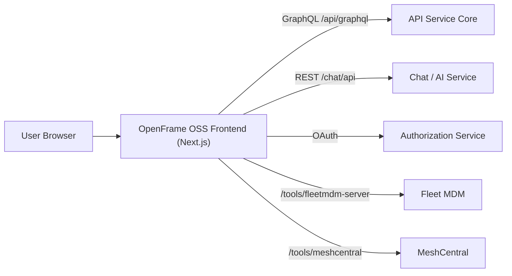

## First Steps

This page walks you through what to do right after you have the OpenFrame OSS Frontend running, how to configure the basics, which key features to explore first, and where to get help. It assumes you have already completed installation as described in `./quick-start.md` and `./prerequisites.md`.

OpenFrame OSS Frontend is the web interface for the OpenFrame platform: a Next.js (App Router) + React + TypeScript application that unifies device management, ticketing, knowledge base, logs/monitoring, scripts, and the Mingo AI assistant into one UI, talking to backend services over GraphQL and REST. The app is published as the `openframe_console` cargo artifact (via the desktop shell in `apps/desktop`) and depends on the `OpenFrame OSS Library` (`@flamingo-stack/openframe-frontend-core`) for shared UI components, hooks, and configuration.



> **Note:** The frontend publishes no consumers of its own inside the organization's code graph — it is the top of the stack, the layer a user's browser talks to directly. It upstream-depends on the `OpenFrame OSS Library` (manual dependency, `@flamingo-stack/openframe-frontend-core`) and pulls in `async_nats` (via the NATS Rust Client) for the desktop shell's background notification plane.

---

### First 5 things to do after installation

1. **Confirm the web app starts and loads.** From `apps/web`, the `dev` script in `apps/web/package.json` runs `next dev -p ${PORT:-3000}`. Open the app in a browser once it's up and verify the sign-in / dashboard shell renders without console errors. If you have not yet installed dependencies or configured the environment, go back to `./prerequisites.md` and `./quick-start.md` first.

2. **Copy and review the environment file.** `apps/web/.env.example` lists the environment variables the frontend reads at build/runtime, including `NEXT_PUBLIC_APP_MODE` (must be `oss-tenant` for this distribution), `NEXT_PUBLIC_ENABLE_DEV_TICKET_OBSERVER`, `NEXT_PUBLIC_AUTH_CHECK_INTERVAL`, and feature flags like `NEXT_PUBLIC_FEATURE_SCRIPT_SCHEDULE`. Copy it to a local `.env` (or your deployment's secret store) and fill in real values for your environment. Full guidance on these variables lives in `../development/setup/environment.md`.

3. **Sign in and check your authenticated session.** Once the app is reachable, log in with the credentials provisioned for your OpenFrame tenant (refer to your environment configuration for the exact account — this repository does not define default credentials). Confirm the dashboard, customers, and devices pages load data, which tells you the GraphQL (`/api/graphql`) and REST (`/chat/api`) connections to the backend are wired correctly.

4. **Register your first device/agent.** From the Devices section, use the install command generation flow (backed by `useInstallCommand` in `apps/web/src/app/(app)/devices/hooks/use-install-command.ts`, which composes server URL, registration secret, and release version into a platform-specific command). Installing an agent on a real endpoint is the fastest way to verify the whole chain — frontend, gateway, and backend — end to end. The detailed walkthrough for this continues in `./how-to/install-the-agent.md`.

5. **Explore the Help Center inside the app.** The frontend ships a built-in Help Center (`apps/web/src/app/(app)/help-center`) with FAQs, onboarding guides, release notes, roadmap, and knowledge-base browsing. Before reaching for external channels, check there first — it is part of the product itself and already wired to your tenant's content.

---

### Common initial configuration

Most of what you configure immediately after installation lives in environment variables and a handful of settings screens inside the app itself.

**Environment variables** (`apps/web/.env.example`):

| Variable | Purpose |
|---|---|
| `NEXT_PUBLIC_APP_MODE` | Deployment mode: `oss-tenant` for this distribution (`saas-tenant` / `saas-shared` are for other builds) |
| `NEXT_PUBLIC_ENABLE_DEV_TICKET_OBSERVER` | Enables automatic devTicket detection/exchange for SSO authentication — leave `false` unless you are debugging SSO |
| `NEXT_PUBLIC_AUTH_CHECK_INTERVAL` | How often (ms) the app polls authentication status; defaults to `60000` |
| `NEXT_PUBLIC_GTM_CONTAINER_ID` | Optional Google Tag Manager container |
| `NEXT_PUBLIC_FEATURE_SCRIPT_SCHEDULE` | Toggles the script-scheduling feature |
| `NEXT_PUBLIC_PR_NUMBER_ENABLED` | Adds a PR-number field to the signup form; keep disabled outside dev |

For a deeper explanation of how these interact with the rest of the stack (tenant host resolution, SaaS shared mode vs. tenant-isolated domains), see `../development/setup/environment.md` and the architecture notes under `../reference/architecture/api-client/api-client.md` (the `AuthApiClient` and `FleetApiClient` sections describe exactly how URL resolution and token handling depend on these values).

**Build and run scripts** worth knowing from `apps/web/package.json`:

```bash
npm run dev            # next dev -p ${PORT:-3000}
npm run build           # generate-enums + relay-compiler + next build
npm run start           # next start -p ${PORT:-3000}
npm run lint             # eslint with cached results
npm run test            # vitest run + node-based lib tests
```

If you are running the desktop shell (`apps/desktop`) or mobile shell (`apps/mobile`), each has its own placeholder/build scripts for the bundled web assets — `apps/desktop/package.json` exposes `web:placeholder` and `build:web`, and `apps/mobile/package.json` exposes the same plus Capacitor's `sync`, `open:ios`, and `run:ios`. Mobile-specific native configuration (push notifications, keyboard behavior, splash screen) is defined in `apps/mobile/capacitor.config.ts`.

**Tenant and SSO configuration** is handled from within the app's Settings area once you're signed in — SSO providers, OAuth clients, and organization-level AI configuration are editable there rather than through repository files. The architecture behind multi-tenant host resolution (dedicated tenant domains vs. shared SaaS host vs. local dev) is documented in `../reference/architecture/api-client/api-client.md`.

For a full environment setup walkthrough (Node version, package manager, local dependencies), see `../development/setup/environment.md`, and for running the whole stack locally see `../development/setup/local-development.md`.

---

### Exploring key features

Once the app is configured and you can sign in, these are the areas worth exploring first, roughly in the order a new MSP operator would touch them:

**Devices** — the centralized `Device` model unifies hardware/OS metadata, installed tools, policies, and tags, with Fleet MDM and MeshCentral linkage. From a device's detail page you can open a remote shell, remote desktop session, or file manager. Device actions (archive, delete, remote access) are abstracted through `useDeviceActionsMenu`. See `../reference/architecture/openframe-oss-frontend/openframe-oss-frontend.md` for the full data-flow diagram, and continue into `./how-to/install-the-agent.md` and `./how-to/start-a-remote-session.md` for task-level walkthroughs.

**Customers** — organization management with cursor-based pagination, device counts per org, and per-customer AI assistant configuration (appearance, provider/model, answer style, quick actions) with the ability to inherit tenant-wide defaults or override them, implemented in `apps/web/src/app/(app)/customers/components/customer-ai-configuration/customer-ai-configuration.tsx`.

**Tickets** — lifecycle management, kanban reordering, assignment, and chat/AI-assisted workflows, described in `../reference/architecture/ticket-service/ticket-service.md`.

**Mingo AI (chat)** — the AI-driven dialog system with streaming responses, context-aware entity references, and approval workflows for AI-triggered actions. The frontend's typed client for this is documented in `../reference/architecture/api-service/api-service.md`, which covers dialog creation, message sending, approve/reject flows, and generation cancellation against the `/chat/api/v1/*` endpoints.

**Scripts** — create, assign, and schedule scripts against devices, with execution monitoring; see `./how-to/create-a-policy.md` for the related policy workflow once you're ready to automate device compliance.

**Logs & Monitoring** — Relay-paginated log tables with date-range and device/organization filtering.

**Knowledge Base** — article authoring, folders, tags, and attachments, browsable both from the admin UI and the in-app Help Center.

For the complete module-by-module reference, including diagrams of how each feature talks to the shared API Client and state layers (React Query, Relay, Zustand), start at `../reference/architecture/README.md` and drill into the frontend-core component references linked from there, such as `../reference/architecture/frontend-core/auth-context/auth-context.md`, `../reference/architecture/frontend-core/chat-components/chat-components.md`, and `../reference/architecture/frontend-core/hooks/hooks.md`.

---

### Where to get help

- **In-app Help Center** — FAQs, onboarding guides, release notes, and knowledge base, available directly inside the application at `apps/web/src/app/(app)/help-center`.
- **OpenMSP Slack community** — this project does not use GitHub Issues or GitHub Discussions for support; everything is managed in the OpenMSP Slack community at https://www.openmsp.ai/ (invite link: https://join.slack.com/t/openmsp/shared_invite/zt-36bl7mx0h-3~U2nFH6nqHqoTPXMaHEHA).
- **Architecture reference docs** — for understanding how a feature is implemented under the hood before asking, check `../reference/architecture/README.md` and the module-specific pages linked from it (API client, API services, frontend-core sub-modules, etc.).
- **Contributing guidelines** — if you plan to submit changes, read `../development/contributing/guidelines.md` first.
- **Security and testing practices** — see `../development/security/README.md` and `../development/testing/README.md` before changing anything security- or test-sensitive.
- **General development setup** — `../development/README.md` is the entry point for all development-focused documentation, including `../development/architecture/README.md` for a broader system view.

---

### Continuing from here

Once you've completed the steps above, the how-to guides take over for specific tasks:

- `./how-to/install-the-agent.md` — the full agent installation walkthrough referenced in step 4 above.
- `./how-to/start-a-remote-session.md` — opening a remote desktop or remote shell session against a registered device.
- `./how-to/create-a-policy.md` — defining policies/scripts to enforce device compliance.

For a broader introduction to the platform before diving deeper, revisit `./introduction.md`; for the installation steps that precede this page, see `./quick-start.md` and `./prerequisites.md`.
