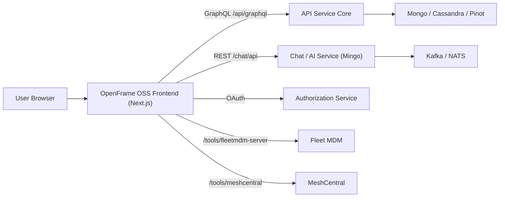

# Introduction

## What is OpenFrame OSS Frontend?

**OpenFrame OSS Frontend** is the web interface for [OpenFrame](https://openframe.ai), the unified MSP (Managed Service Provider) platform from [Flamingo](https://flamingo.run). Flamingo builds an AI-powered MSP stack that replaces expensive proprietary tools with open-source alternatives enhanced by intelligent automation — Mingo AI for technicians, Fae for clients. OpenFrame is the product that ties those tools into a single, AI-driven interface.

This repository implements the **presentation and orchestration layer** of OpenFrame: the Next.js (App Router) + React + TypeScript application that MSP technicians and administrators use every day to manage customers, devices, tickets, knowledge base content, logs, and AI-assisted workflows.

> This repository also bundles Capacitor (`apps/mobile`) and Tauri (`apps/desktop`) shells that wrap the same web build for native mobile and desktop delivery, alongside the primary web application in `apps/web`.

## Elevator Pitch

If you run an MSP, or build tooling for one, OpenFrame OSS Frontend gives you a single screen for operations that would otherwise require juggling several disconnected SaaS dashboards: device management (Fleet MDM), remote access (MeshCentral), ticketing, knowledge base, scripting, and an AI assistant (Mingo) that can act on your behalf across all of it — all wrapped in one multi-tenant, SaaS-ready web application.

## Key Features and Benefits

- **Unified device and customer management** — a cursor-paginated customers table, device inventory with hardware/OS/network/software tabs, and per-customer AI configuration and guardrails, all under `apps/web/src/app/(app)/customers` and `apps/web/src/app/(app)/devices`.
- **Integrated remote operations** — remote shell, remote desktop, and a custom browser-based MeshCentral client (binary frame decoding, tile rendering, file manager) implemented in `apps/web/src/lib/meshcentral`.
- **Ticketing and knowledge base** — ticket lifecycle, transitions, and chat integration, plus an article/folder-based knowledge base with tagging and attachments.
- **Mingo AI assistant** — a streaming, context-aware AI chat experience (`apps/web/src/app/(app)/mingo`) that can read the user's current view, referenced entities, and recent navigation history, and that can request human approval before taking an action.
- **Scripting and RMM-style operations** — script creation, device/organization assignment, scheduling, and execution monitoring against machines managed through Fleet MDM.
- **Logs and monitoring** — Relay-paginated log tables with date-range and device/organization filtering.
- **Multi-tenant, SaaS-ready architecture** — the frontend adapts its API base URL for dedicated tenant domains, a shared SaaS host, or local development, with consistent token refresh and auth handling centralized in the API client layer.
- **Typed, consistent API access** — a shared API client (`AuthApiClient`, `FleetApiClient`) standardizes authentication, retries, and response envelopes across REST and GraphQL calls.
- **Cross-platform delivery** — the same web UI is packaged for the browser (`apps/web`), mobile via Capacitor (`apps/mobile`), and desktop via Tauri (`apps/desktop`, publishing the `openframe_console` crate).

## Target Audience

- **MSP technicians and administrators** using OpenFrame day-to-day to manage customer devices, tickets, scripts, and knowledge base content.
- **Frontend engineers** contributing to the Next.js/React codebase, its component library, hooks, and state management.
- **Platform/DevOps engineers** building and deploying the web, mobile, and desktop variants of OpenFrame.
- **Open-source contributors** interested in the Flamingo/OpenFrame ecosystem who want to extend MSP tooling with AI-driven automation.

## How This Fits the Wider System

OpenFrame OSS Frontend is the human interface layer of the OpenFrame platform. It talks to backend services over GraphQL and REST, and to device-management tools directly:

Per the organization's dependency graph, this repository publishes a `cargo` artifact named `openframe_console` (the Tauri desktop shell, version `0.1.0`), and it pins dependencies on the `OpenFrame OSS Library` (manual dependency on `flamingo-stack/openframe-oss-lib`, which supplies shared backend modules such as `api-lib-dto`, `api-lib-service`, `authorization-service-core`, and more) and on `async_nats`, a Rust NATS client sourced from the `flamingo-stack/nats.rs` fork used by the desktop app's background notification plane. No other repository is currently recorded in the graph as a consumer of this one, though graph coverage is partial — an empty consumer list does not prove nothing depends on it.

For a deeper architectural walkthrough of each module (API client, DTOs, services, authorization, device/data layers, and every frontend-core sub-area), see the [Architecture reference](../reference/architecture/README.md).

## Repository Layout at a Glance

- `apps/web` — the primary Next.js frontend (`openframe-frontend`), the focus of most day-to-day development.
- `apps/mobile` — a Capacitor shell (`openframe-mobile`) wrapping the web export for native iOS/Android delivery; no UI code lives here.
- `apps/desktop` — a Tauri shell (`openframe-console`) wrapping the web export for desktop delivery, with its Rust backend under `apps/desktop/src-tauri`.

## Technology Stack

The web application (`apps/web/package.json`) is built on:

- **Next.js** (App Router) with **React** and **TypeScript**
- **GraphQL** via `react-relay` / `relay-runtime`, plus **REST** through a shared API client
- **TanStack React Query** for server-state caching and pagination
- **Zustand** for client-side UI/session state
- **React Hook Form** + **Zod** for forms and validation
- **CodeMirror** for in-browser script/query editing
- **Tailwind CSS** for styling
- **Vitest** for testing

It depends on `@flamingo-stack/openframe-frontend-core`, a shared UI primitives package published from the `flamingo-stack/openframe-oss-lib` repository.

## License

This repository is licensed under **The Flamingo AI Unified License v1.0** (© 2025 Flamingo AI, Inc.), as stated in `LICENSE.md`. The license covers all Flamingo AI products, including OpenFrame, and serves as both the license and terms of use. It notes that upstream components bundled with Flamingo software (for example Fleet, Osquery, and the MeshCentral Agent) remain under their own original licenses, listed in the license's appendix.

## Where to Go Next

- [Prerequisites](./prerequisites.md) — what you need installed before working with this repository.
- [Quick Start](./quick-start.md) — get the frontend running quickly.
- [First Steps](./first-steps.md) — orient yourself after the initial setup.
- [Install the Agent](./how-to/install-the-agent.md) — connect a device to OpenFrame.
- [Create a Policy](./how-to/create-a-policy.md) — configure device policies.
- [Start a Remote Session](./how-to/start-a-remote-session.md) — use the remote shell/desktop features.
- [Development overview](../development/README.md), including [environment setup](../development/setup/environment.md), [local development](../development/setup/local-development.md), [testing](../development/testing/README.md), [security](../development/security/README.md), and [contributing guidelines](../development/contributing/guidelines.md).
- [Architecture reference](../reference/architecture/README.md) for a full breakdown of every module, including the [frontend-core](../reference/architecture/frontend-core/frontend-core.md) component library.

For community support and discussion, the project uses the **OpenMSP** Slack community (https://www.openmsp.ai/) rather than GitHub Issues or Discussions.
