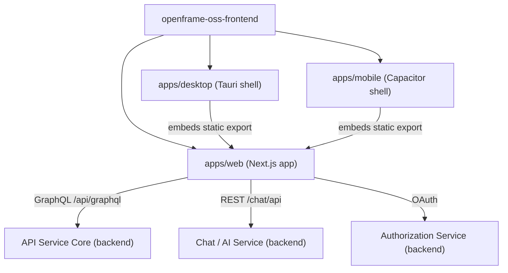

# Quick Start

This guide gets the OpenFrame OSS Frontend web app running locally in a few minutes, walks you through a basic "Hello World" style verification (loading the app and confirming it serves pages), and points you to what to read next.

> This repository hosts three app shells that share one Next.js codebase: a web app (`apps/web`), a desktop shell (`apps/desktop`, a Tauri/Rust wrapper that embeds the web app's static export), and a mobile shell (`apps/mobile`, a Capacitor wrapper around the same export). This Quick Start focuses on `apps/web`, the fastest path to a running UI.

## Before you start

You need Node.js matching the version pinned in `.nvmrc` (major version 24) and npm `>=11.11.0` (declared under `devEngines.packageManager` in `apps/web/package.json`). If you have not reviewed environment requirements yet, see [Prerequisites](./prerequisites.md).

For a deeper architectural tour before diving into code, read [Introduction](./introduction.md). For this document, the short version is enough: OpenFrame OSS Frontend is the Next.js (App Router) UI for the OpenFrame MSP platform, talking to backend services over GraphQL and REST, with a shared UI/auth/library layer pulled in from `@flamingo-stack/openframe-frontend-core`.

---

## TL;DR: 5-minute setup

```bash
# 1. Clone the repository
git clone https://github.com/flamingo-stack/openframe-oss-frontend.git
cd openframe-oss-frontend

# 2. Move into the web app
cd apps/web

# 3. Install dependencies (npm, not yarn/pnpm — package.json pins devEngines.packageManager)
npm ci

# 4. Create your local environment file
cp .env.example .env.local

# 5. Start the dev server
npm run dev
```

By default `npm run dev` runs `next dev -p ${PORT:-3000}` (see the `dev` script in `apps/web/package.json`), so the app is served at `http://localhost:3000` unless you override `PORT`.

```bash
# Optional: run on a different port
PORT=4000 npm run dev
```

> **Note on dependencies:** `apps/web/package.json` pulls `@flamingo-stack/openframe-frontend-core` from a `pkg.pr.new` prerelease tarball URL rather than a registry version. `npm ci` resolves it like any other tarball dependency — no extra step is needed, but expect the install to fetch it over the network.

---

## What gets installed

Key pieces of the stack you just installed, straight from `apps/web/package.json`:

| Concern | Package(s) |
|---|---|
| Framework | `next` (16.3.6), `react` / `react-dom` (19.2.4) |
| Shared UI/auth/core | `@flamingo-stack/openframe-frontend-core` |
| Data fetching | `@tanstack/react-query`, `react-relay` / `relay-runtime`, `graphql` |
| Forms & validation | `react-hook-form`, `@hookform/resolvers`, `zod` |
| State | `zustand`, `immer` |
| Code/editor widgets | `@codemirror/*` packages |
| Terminal UI | `@xterm/xterm`, `@xterm/addon-fit` |
| Styling | `tailwindcss` (theme and plugins from the core library preset), `postcss`, `autoprefixer` |

Dev tooling includes `eslint`, `prettier`, `vitest`, `typescript`, and `relay-compiler` (devDependencies in the same file).

---

## Configure your environment

`apps/web/.env.example` documents the environment variables the app reads at build/run time. Copy it to `.env.local` and adjust as needed:

```bash
# OpenFrame React Frontend Environment Variables

# 'oss-tenant' | 'saas-tenant' | 'saas-shared'
NEXT_PUBLIC_APP_MODE=oss-tenant

# Enable/disable the global DevTicket observer for SSO authentication
NEXT_PUBLIC_ENABLE_DEV_TICKET_OBSERVER=false

# How often to check authentication status (in milliseconds)
NEXT_PUBLIC_AUTH_CHECK_INTERVAL=60000

NEXT_PUBLIC_GTM_CONTAINER_ID=

# Script Schedule feature flag
NEXT_PUBLIC_FEATURE_SCRIPT_SCHEDULE=false

# PR Number field on the signup form (dev environments only)
NEXT_PUBLIC_PR_NUMBER_ENABLED=false
```

For an OSS deployment, `NEXT_PUBLIC_APP_MODE=oss-tenant` (the default in `.env.example`) is the mode you want — it tells the frontend to resolve API calls relative to its own origin rather than a shared SaaS host.

For a complete walkthrough of every available environment variable and how they interact with tenancy and auth, see [Environment Setup](../development/setup/environment.md).

---

## Basic "Hello World": running and verifying the app

Once `npm run dev` is up, open your browser to confirm the app serves correctly.

### Step 1 — Confirm the dev server is up

```bash
cd apps/web
npm run dev
```

Expected terminal output looks like Next.js's standard dev banner, something close to:

```text
  ▲ Next.js 16.3.6
  - Local:        http://localhost:3000

 ✓ Ready in 1.2s
```

### Step 2 — Open the app in a browser

Navigate to `http://localhost:3000` (or whichever port you set via `$PORT`). You should see the OpenFrame sign-in / app shell render without a server error page. Because `NEXT_PUBLIC_APP_MODE=oss-tenant`, the frontend expects its own origin to serve the backend APIs it calls (GraphQL at a path like `/api/graphql`, per the architecture overview in [Architecture](../development/architecture/README.md)) — without a backend running behind it, you will see the UI shell but API-dependent views (dashboard stats, device lists, etc.) will show loading or error states. That is expected for a frontend-only Quick Start; wiring up the backend is covered in [First Steps](./first-steps.md).

### Step 3 — Run the test suite as a smoke check

A fast way to confirm your checkout is healthy without a backend at all:

```bash
npm run test
```

This runs `vitest run` followed by `npm run test:node` (which runs `node --test src/lib/*.test.mjs`), per the `test` script in `apps/web/package.json`. A clean pass confirms your Node version, dependency install, and TypeScript config are all compatible.

### Step 4 — Type-check and lint (optional but recommended)

```bash
npm run type-check
npm run lint
```

`type-check` runs `tsc --noEmit`; `lint` runs ESLint with `--max-warnings 0` against the cached config. These are the same checks your pull request will be judged against — see [Contributing Guidelines](../development/contributing/guidelines.md).

---

## Expected results

| Command | What success looks like |
|---|---|
| `npm ci` | Exits 0; `node_modules/` populated including `@flamingo-stack/openframe-frontend-core` |
| `npm run dev` | Terminal prints "Ready" banner; `http://localhost:3000` serves the app shell |
| `npm run test` | `vitest run` reports all test files passing, followed by the Node test runner summary |
| `npm run type-check` | No TypeScript errors printed |
| `npm run lint` | No ESLint errors/warnings (threshold is zero) |

If `npm run dev` fails immediately with a module resolution error, re-run `npm ci` from inside `apps/web` — this repo uses npm workspaces semantics at the app level, and partial installs are the most common first-run failure.

---

## Building for other targets

The web app also builds a production bundle and a static export used by the desktop and mobile shells:

```bash
# Standard Next.js production build (generates GraphQL enums, runs relay-compiler, then next build)
npm run build

# Static export build, consumed by the desktop/mobile shells
npm run build:export
```

`apps/desktop/scripts/build-web.sh` runs `OPENFRAME_BUILD_TARGET=export npm run build` inside `apps/web` and stages the resulting `dist/` directory into the desktop shell's `www/` folder — this is how `apps/desktop` (a Tauri app, see `apps/desktop/src-tauri/Cargo.toml`) and `apps/mobile` (a Capacitor shell) embed the same UI without duplicating it. You do not need to touch the desktop or mobile shells for a basic frontend Quick Start; they are mentioned here so the repository layout makes sense if you browse further.

---

## Repository structure at a glance



This diagram reflects the module responsibilities documented in [Architecture Overview](../reference/architecture/README.md); the backend services it names live outside this repository.

---

## Where this fits in the ecosystem

This repository publishes a cargo artifact, `openframe_console` (the desktop shell's Rust crate), and consumes `async_nats` from the organization's NATS Rust Client fork plus the shared library from OpenFrame OSS Library. No other repository in the indexed graph currently consumes this one as a dependency — it sits at the top of the delivery chain, packaged as a container image (`ghcr.io/flamingo-stack/openframe-oss-frontend/openframe-oss-frontend`) by its release and test CI workflows.

---

## Next steps

Once the app is running locally:

- Walk through [First Steps](./first-steps.md) for a guided tour of core workflows after installation.
- Read the [Development Environment Setup](../development/setup/environment.md) guide for the full list of environment variables and tenancy modes.
- Follow [Local Development](../development/setup/local-development.md) for day-to-day developer workflows (linking `@flamingo-stack/openframe-frontend-core` locally via `npm run core:link`, watching Relay queries with `npm run relay:watch`, etc.).
- Review the [Architecture Overview](../development/architecture/README.md) and the deeper [Reference Architecture](../reference/architecture/README.md) to understand how customers, devices, tickets, logs, and the Mingo AI chat modules are organized under `apps/web/src/app`.
- Check [Testing](../development/testing/README.md) before submitting changes, and [Security](../development/security/README.md) for authentication and token-handling conventions used throughout the API client layer (documented in [API Client](../reference/architecture/api-client/api-client.md)).
- Read [Contributing Guidelines](../development/contributing/guidelines.md) before opening a pull request.

If you get stuck, the project is community-supported through the OpenMSP Slack community rather than GitHub Issues or Discussions.
